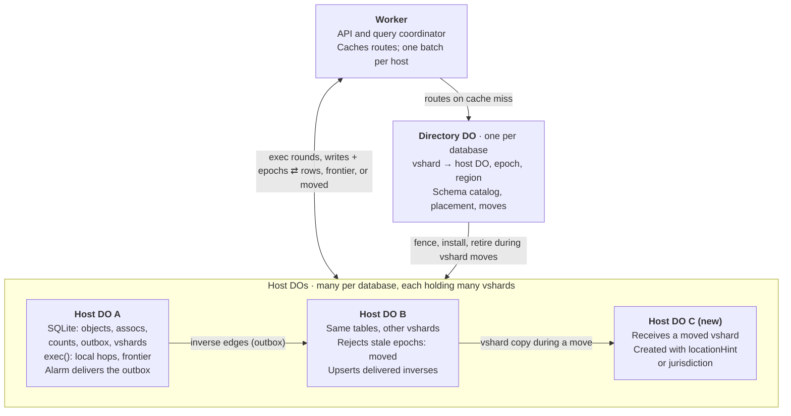

# Hlekk: Design

Oct 28, 2026 · @Matt Wonlaw

## Summary

Hlekk, Old Norse for a chain link, is a TAO-style object-and-edge database built on actors. This design targets Cloudflare Durable Objects (DOs) first; the model fits any actor platform whose actors have durable local storage, such as Rivet. The infrastructure, not the application, owns partitioning, placement and capacity. Developers create objects in a logical database and never size, pick or reshard DOs.

**Goals**

- Stable 64-bit object IDs that survive moves between DOs and regions.
- Graph reads (an object plus related objects, several levels deep) in as few network rounds as the data's locality allows.
- A database grows from one DO to many with no application changes.
- Transactions within a colocation group, and inverse edges that are guaranteed to arrive eventually.
- A small database costs exactly one DO.
- Teams add object and edge types independently, without a shared god class.

**Non-goals for v1**

- Arbitrary SQL, ad-hoc joins or scans.
- Transactions across colocation groups.
- Incremental view maintenance (IVM) and change subscriptions. These are parked, not rejected.
- Regional read followers and R2 tiering. The design leaves room for both.

D1 already offers SQL with read replicas, up to 10 GB per database. This system targets apps that outgrow one DO, read graph-shaped data, and should not have to shard by hand.

## Principles

1. **Identity, ownership, storage and read serving are separate.** An object's ID never changes. The DO that owns its writes can change. Where cached copies are served is a separate decision again.
2. **Move, never split.** IDs embed one of many small, fixed logical shards (vshards). A database is pre-sharded, so even its first write lands in one of many. Capacity is managed by the allocator and by moving whole vshards between DOs. No split protocol, no log lineage, no transaction group cut in half.
3. **The query rides, control stays central.** Each host DO resolves everything it holds and ships back what it read. One coordinator runs the query once and batches its reads per host.
4. **Routing is a hint; the owner enforces.** Cached routes can be stale. The owning DO checks the epoch on every request and answers `moved` when it no longer owns a vshard.
5. **One mutation, one local transaction.** The ownership check, the data write, counts and the outbox row commit together in one SQLite transaction on one host.
6. **A restricted API.** Objects, edges (assocs), edge counts and ordered edge-list ranges. No scans, so every operation is cheap to route and cheap to cache.
7. **Fail loudly.** Storage formats and protocols are chosen so mistakes raise errors instead of corrupting data, for example BLOB IDs and epoch-checked writes.
8. **Small stays small.** A database that fits in one DO runs in one DO. Scaling out happens only under pressure.
9. **The catalog is the source of truth.** Object types list only their fields, and edge types are separate entries owned by domains. Code is generated from the catalog, and each product generates a projection holding only the types and edges it uses.
10. **The caller is a trusted server.** Nothing untrusted reaches hlekk. No browser routes to it, and anything client-facing is a layer above. So queries are built rather than declared and validated, IDs are taken at face value, and authorization belongs to the application.

## Motivating examples

An issue tracker exercises every part of the design.

**1. Render an issue page.** One query loads an issue, its comments with their authors, its labels and its owner:

```ts
Issue.gen(id)
  .related('comments', issueComments, q => q.related('author', commentAuthor))
  .related('labels', issueLabels)
  .related('owner', issueOwner);
```

If comments were allocated in the issue's vshard, this takes two network hops: one to the issue's host, then one parallel request per host holding labels or users. A coordinator that walked one hop at a time would need four.

**2. Every task assigned to Alice, across projects.** No fan-out. Assigning a task writes `task -assignee-> alice` on the task's host and the inverse `alice -assigned_tasks-> task` on Alice's host. Listing Alice's tasks is one range read on one host.

**3. Look up a user by email.** The coordinator can't know which host holds that user. This needs a global index sharded by `hash(email)`, maintained through the outbox, with reserve → create → confirm for uniqueness.

**4. A popular issue with 50,000 comments.** `related('comments')` always carries a limit and reads the newest edges first from an ordered index. The comment count comes from a maintained counter, not `COUNT(*)`.

**5. A tenant grows from 1 MB to 500 GB.** The application code doesn't change. The allocator keeps placing new objects in vshards with room, and full or busy hosts hand whole vshards to new DOs.

## Data model and API

The model is TAO's: typed objects with a JSON payload, and typed, ordered edges between them. Object types and edge types are separate entries in the schema catalog, and app code imports definitions generated for its own projection (see Schema catalog and projections). Names and signatures below are a sketch; the operations are the commitment.

**Objects** have an `id` (u64, as a string), an `otype`, a `version` and a JSON `data` payload of at most 2 MB.

**Edges** (assocs) are directed `(id1, atype, id2)` with a `time` sort key and an optional small JSON `data`. An edge lives on id1's vshard. An edge type can declare an inverse type, maintained automatically.

### Edges are separate from objects

No object type lists its edges, so no object becomes a god class. Each domain owns the edge types it declares, including edges between other domains' types.

- **Edges are values.** Code imports the edges it traverses from its generated module. The output name is chosen where the edge is used, so two products can traverse the same edge under different names.
- **Two kinds.** A stored edge is ordered by time, counted, and optionally paired with an inverse. A field relationship follows an ID in the source object's payload: no edge write, but no inverse, count or ordering either.
- **One definition per name and integer.** The catalog rejects a duplicate or a conflicting inverse. Domain prefixes on names keep teams apart.

### Mutations

```ts
// with: hard colocation (same vshard, transactional with the parent)
// near: placement hint only
const cid = await db.create(Comment, { body, authorId }, { with: issueId });
await db.update(cid, { body: 'edited' });           // bumps version
await db.delete(cid);                                // each edge type's onDelete applies

await db.assoc.add(issueComments, issueId, cid, { time: Date.now() });
await db.assoc.remove(issueComments, issueId, cid);

// one local transaction; every touched id must share the anchor's vshard
await db.txn(issueId, tx => { /* creates, updates, edge writes */ });
```

### Point reads

```ts
await db.get([id1, id2]);                                   // objects by id
await db.assoc.get(issueLabels, issueId, [l1, l2]);         // which edges exist
await db.assoc.range(issueComments, issueId, { limit: 50, after: cursor });
await db.assoc.count(issueComments, issueId);
```

### Graph queries

```ts
const r = await Issue.gen(id)
  .related('comments', issueComments, q => q.related('author', commentAuthor).limit(50))
  .related('labels', issueLabels)
  .related('owner', issueOwner)
  .run();
```

- Every `related` has a limit. A default applies when none is given.
- `related` over an `edge` reads the newest edges first by `time`. Indexed `where` and `orderBy` are allowed only on edge fields; see Indexing.
- The result is a normalized graph. Nesting into the query's shape happens last, so each object appears once.
- **Queries are built, not declared.** There is no `defineQuery` or `defineFragment`: a query is the builder's value, and reuse is an ordinary function over it. Rindle needs named, validated queries because an untrusted client sends them; hlekk's caller is a trusted server, so the wrapper would guard nothing. By principle 10 that does not change, so this is not a v1 simplification.

```ts
const card = (q: Query<Issue>) => q.related('owner', issueOwner).related('labels', issueLabels);

const r = await card(Issue.gen(id)).related('comments', issueComments, q => q.limit(50)).run();
```

- **The plan cache keys on structure, not a name.** A canonical AST and a stable hash identify a query, so hosts cache plans and spot identical concurrent requests whether or not anyone named it, and two structurally identical queries written in different places share an entry. An optional `label` rides along for explain and traces.

```ts
type QueryResult = {
  root: Id;
  objects: Record<Id, { otype: string; version: number; data: unknown }>;
  edges: Record<`${Id}:${string}`, { ids: Id[]; cursor?: string; count?: number }>;
};
```

## Schema catalog and projections

The catalog is the source of truth: a versioned, serialized schema, stored as data in each database's directory DO. Code is generated from it, never the other way around, and each product generates only its projection: the types and edges it uses.

This is rindle's flow. In its example app, `server/schema-def.ts` declares the tables, the daemon applies them, and `rindle schema gen` writes `shared/schema.gen.ts` from what the daemon holds; the generated file is a mirror, never a second source. Hlekk differs in two ways. Its serialized form carries what SQL can't (enums, ID references, edge kinds, inverses), so most of rindle's hand-written refinements move into the schema. And generation is per projection, so no generated module holds every team's types.

### Serialized form

Every entry is named `<domain>.<name>`, and its domain owns it. People edit one file per domain, with no integers in it. `schema/issues.json`, owned by the issues team:

```json
{
  "objects": {
    "issues.issue":   { "fields": { "title": "string", "status": { "enum": ["open", "closed"] } } },
    "issues.comment": { "fields": { "body": "string", "authorId": { "id": "core.user" } } },
    "issues.label":   { "fields": { "name": "string" } }
  },
  "edges": {
    "issues.issue_comment":  { "from": "issues.issue", "to": "issues.comment",
                               "inverse": "issues.comment_issue", "onDelete": "cascade" },
    "issues.issue_label":    { "from": "issues.issue", "to": "issues.label" },
    "issues.issue_owner":    { "from": "issues.issue", "to": "core.user", "unique": true,
                               "inverse": "issues.user_owned_issues" },
    "issues.comment_author": { "from": "issues.comment", "to": "core.user", "field": "authorId" }
  }
}
```

- **Edges are their own entries.** `marketplace.listing_buyer`, from `marketplace.listing` to `core.user`, lives in `schema/marketplace.json` and changes nothing in `core.user`'s entry.
- **An edge with `field` is a field relationship.** It follows an ID in the source object's payload. Nothing is stored, so it has no atype.
- **The lock is the canonical form.** Planning a change writes `schema/catalog.lock.json`: every entry, its integer, and the version. Every database applies the same lock, so integers match across development, staging and production.
- **The lock carries a sum** over its canonical form, so two teams who plan on separate branches conflict in git rather than merging to one version that allocated integers twice. Apply would catch it, but only after review.

### Projections

A projection is a named selection of the catalog, declared for the product that uses it. It decides what that product's generated code contains and changes no data. `schema/projections/issues-web.json`:

```json
{
  "name": "issues-web",
  "include": ["issues.*", "core.user"],
  "fields": { "core.user": ["name"] }
}
```

- **Select by name.** A glob takes a whole domain; single entries can come from other domains.
- **Unselected endpoints become references.** An included edge whose target type isn't selected yields a `Ref`: an ID you can hold, pass on and link to, with no fields.
- **Fields can be narrowed.** `fields` limits what a type exposes. A create is generated only when the projection holds every required field; an update writes only projected fields.
- **Isolation by selection.** issues-web's `User` has no listing purchases; the marketplace app's projection includes them. Selection, not imports, is what keeps any type from becoming a god class.
- **Projections live beside the domain files**, so a plan sees who uses what, and refuses to remove a type that a projection still includes.

### Generated code

`hlekk gen issues-web` reads the lock and writes one module; app code imports from it alone.

```ts
// schema.gen.ts: generated from catalog v42 for projection issues-web. Do not edit.
export const projection = { name: 'issues-web', catalog: 42, hash: '9f3c…' } as const;

export const User    = defineObject('core.user', 4, { name: string() });   // narrowed to name
export const Issue   = defineObject('issues.issue', 1, { title: string(), status: oneOf('open', 'closed') });
export const Comment = defineObject('issues.comment', 2, { body: string(), authorId: id(User) });
export const Label   = defineObject('issues.label', 3, { name: string() });

export const issueComments = edge('issues.issue_comment', 1, Issue, Comment);
export const issueLabels   = edge('issues.issue_label', 2, Issue, Label);
export const issueOwner    = edge('issues.issue_owner', 3, Issue, User, { unique: true });
export const commentAuthor = fieldRel('issues.comment_author', Comment, User, 'authorId');
```

- **Integers on the wire.** Requests name types by integer, so a rename never breaks a deployed client. Names serve people and error messages.
- **Requests carry the catalog version and projection hash.** A change since that version that touches none of the projection's entries never invalidates the client.
- **Refinements the schema can't express**, such as a JSON field's TypeScript shape, go in a hand-written module over the generated one, as with rindle's `refineTable`, so they survive regeneration.
- **Other languages** get generators over the same lock and projection.

### What the catalog holds

| Entry | Holds |
| --- | --- |
| Domain | Name, owning team |
| Object type | Name, otype integer, field schema |
| Edge type | Name, atype integer (stored edges only), kind (stored or field), source and target types, inverse, data schema, onDelete |
| Index | Expression indexes per object type; global lookup indexes |
| Projection | Name, selection, hash |
| Version | A monotonic number; each applied lock is the next |

Integers are identity and are never reused. Names are labels. Hosts need the whole catalog even though each product sees only its projection: the outbox writes inverses, and deletes apply every team's `onDelete`.

### Migrating

1. **Edit.** A team changes its domain's file; a product changes its projection. Code review on those files is the ownership check.
2. **Plan.** `hlekk schema plan` diffs the files against the lock, classes each change by its cost (below), allocates integers for new types, and writes lock version N + 1. The lock is reviewed with the files.
3. **Apply.** Each database's directory compare-and-sets its catalog from version N to N + 1. It re-checks what it can: one definition per name and integer, no integer reused, every reference resolves, and no tombstoned name is reused before a purge.
4. **Generate.** Products regenerate from the lock. A change outside a projection leaves its generated module unchanged.
5. **Propagate.** Requests carry the catalog version they were built against. A host behind that version fetches the catalog from the directory before serving; a host ahead of it serves, since nothing is hidden while a registered projection still includes it.

### What a change costs

Objects are stored as JSON, so the catalog is a lens over stored data, not its layout. Most changes edit the lens and touch no rows; hosts pick them up with the next catalog version. Only two kinds of change touch data: a check that existing rows meet a stricter rule, and a build of derived rows such as inverses and indexes.

| Change | Cost | What happens to stored data |
| --- | --- | --- |
| Add an object type, edge type or optional field | Catalog only | Nothing |
| Remove a field | Catalog only | Stays in the JSON, hidden on read; an old client's write of it is dropped |
| Remove an object or edge type | Catalog only | Writes refused, reads return nothing; rows stay until garbage collection |
| Rename a field or type | Catalog only | A field aliases its stored key; a type keeps its integer |
| Make a field optional, or required with a default | Catalog only | A missing value reads as null or the default |
| Add an enum value, widen an edge's target types, change onDelete | Catalog only | Nothing; applies to later writes and deletes |
| Change a projection | Catalog only | Nothing; regenerate |
| Make a field required without a default, narrow a type or enum, add unique | Catalog + check | A background scan per vshard verifies existing rows; new writes follow the rule at once |
| Add an inverse to an existing edge type, or a global lookup index | Catalog + build | Backfill per vshard; reads of the new data end short until it completes |
| Add an expression index | Catalog + build | Each host runs one CREATE INDEX when it wakes |
| Change a field's type or an edge's sort key | Not a schema change | Declare a new field or edge type and migrate in app code |

**Checks commit last.** New writes follow a stricter rule as soon as it is applied; the catalog marks it in force once every vshard's scan passes, like Postgres's `NOT VALID` followed by `VALIDATE CONSTRAINT`. Checks and builds run like vshard moves: the directory drives them per vshard, resumably, with alarms.

**Hidden data still exists.** A removed field's values stay in stored JSON, so its name is tombstoned: re-adding it would bring old values back. Garbage collection, which strips hidden fields and deletes rows of removed types, is optional housekeeping, except as a purge when data must be erased or a name reused.

Deploys expand, then contract. Apply new types to every database before deploying code that uses them; stop using a type in code before removing it.

## Architecture

Three kinds of component: a Worker that coordinates, one directory DO per database that also holds the schema catalog, and many host DOs that own vshards. Reads and writes go from the Worker straight to hosts.



The directory is consulted only on a route-cache miss, and it drives vshard moves. When the data is far from the user, the coordinator loop can run on the root's host DO instead of the Worker.

## Client API

An app reaches a database from an ordinary Worker. Nothing about placement appears in the API: the caller holds IDs, and the client resolves hosts.

The caller is always a trusted server. Nothing untrusted reaches hlekk, so there is nothing here to validate and no authorization to express; a client-facing surface is a layer above this one.

### Bindings

A database is three Cloudflare resources, so scoping a request to one takes a small config object rather than a single binding.

```ts
import { Hlekk } from 'hlekk';

const open = (env: Env) => Hlekk.from({
  directory: env.HLEKK_DIRECTORY, // DO namespace: one directory DO per database
  hosts:     env.HLEKK_HOSTS,     // DO namespace: idFromName(`issues/h-7`)
  map:       env.HLEKK_MAP,       // KV namespace: m/issues/<chunk>
  database:  'issues',            // names the directory DO; scopes host names and map keys
});
```

`database` is what scopes the other two, so many databases can share one pair of namespaces. A deployment that gives each database its own namespaces still works, and the names do not change.

### The client is per isolate, not per request

`Hlekk.from` is memoized per database and returns the same client for the life of the isolate, so calling it in a handler costs nothing after the first time. This is not a convenience. The isolate's shard-map chunks are what keep the directory and KV off the request path, and a client built fresh per request reuses none of them: every request would pay a route lookup. There is no exported constructor, so the cached path is the only path.

Memoization rather than a module-scope constant is what makes this work at all, since `env` reaches a Worker per request. A Worker that has `env` at the top level can hold the client in a module constant instead, and it is the same client either way. Construction is lazy regardless, because Workers forbid I/O at module scope, so the first request through a cold isolate pays the chunk fetch. That is the cold start the published snapshot exists to absorb.

### Queries

A query is built where it is used, from IDs the caller already holds, and follows edges from there. There is no query registry and nothing to declare up front.

```ts
export default {
  async fetch(req: Request, env: Env): Promise<Response> {
    const db = open(env);
    const viewer = await authenticate(req);   // the app's job, not the database's

    const r = await db.query(
      User.gen(viewer)
        .related('assigned', userAssignedIssues, q => q.related('owner', issueOwner).limit(50))
        .countAs('assignedCount', userAssignedIssues)
    );

    return Response.json(r);
  },
};
```

The acting user is an ID the Worker resolved from its own authenticated state, and the database treats it as any other ID. **Authorization is the application's**, as with any database reached from a trusted server: hlekk decides where an object lives, not who may read it. A caller that forwards an ID straight from a request has authorized nothing, which is the same mistake as interpolating one into SQL.

Point reads and writes route the same way: `db.get`, `db.assoc.*`, `db.create`, `db.update` and `db.txn(anchorId, …)` all resolve a vshard from an ID and go to the one host that owns it. Every request carries the catalog version and projection hash the client was generated against.

### What a query costs from a Worker

Starting from a viewer ID the caller already holds, on a warm isolate:

1. **Decode the vshard** from the ID: a bit shift, no lookup. This is what the vshard in the high bits buys.
2. **Resolve the host**: a binary search in the cached chunk, in process.
3. **One `exec`** to that host, carrying the plan and the root as its only task.
4. **The host runs the plan below the root** over its own data and ships back everything it read, plus what it missed.
5. **The coordinator fills what is left**, one batched request per host per tick.

So a root plus data colocated with it is one round trip, and a root whose related objects live elsewhere is two. A cold isolate adds one KV read in front of step 2. A stale route costs a `moved` reply and one more round, never a wrong answer.

### Where the loop runs

The coordinator is the same code in a Worker or a DO, so a Worker that lands far from the data can hand the loop to the root's host DO instead: one long round trip, then short hops inside the data's region. Whether that choice is automatic or exposed to the caller is an open question.

## IDs and sharding

Every ID is an unsigned 64-bit integer whose high bits name its vshard. IDs are strings in the API and in JSON payloads, and 8-byte big-endian BLOBs in SQLite.

IDs are unique within one database: one graph, with one ID space, catalog and directory. The mechanism is TAO's. Each vshard owns the slab of IDs under its prefix, so no two IDs collide. Separate databases number their vshards independently, so an ID means nothing without its database.

| TAO paper | This doc | What it is |
| --- | --- | --- |
| Logical shard, each in its own MySQL logical database | vshard | Unit of placement; owns a slab of IDs |
| Database server | host DO | Holds many vshards |
| TAO itself, one per company | database | One graph: one ID space, catalog and directory |

Separate ID spaces keep copies cheap: restoring a backup or branching staging off production is a byte copy. The cost is that an ID used against the wrong database resolves to whatever object has that number there, instead of failing.

### Layout

| Bits | Field | Notes |
| --- | --- | --- |
| 63–40 | vshard | 24 bits, about 16.7M vshards per database (proposed split) |
| 39–0 | sequence | Allocated per vshard from `vshards.next_seq` |

**Why 40 sequence bits.** Bytes and IDs are separate budgets: bytes count live data, while IDs count every object ever created, including deleted ones. A colocation group creating 10 objects a second with 2-day retention holds about 1.7M live rows but uses 315M IDs a year. A 2^27 slab would run out in about 5 months; 2^40 lasts about 3,500 years. Vshard bits aren't scarce either: 2^24 vshards at 1 GB each is 16 PB.

**No timestamp.** IDs already ascend within a vshard, the only place they're stored together, so inserts append to the B-tree without a clock. Putting time first would break each vshard's contiguous key range, which moves copy. Putting it inside the sequence costs counter bits and suffers clock skew after a move. Ordering by time uses an edge's `time`, or a `created` field where a type needs one.

### Why BLOB storage

- SQLite coerces an integer string to INTEGER only up to 2^63−1. Above that it becomes a REAL, and two distinct IDs can compare equal. A local `sqlite3` test confirmed this.
- The DO SQL API returns integers as JS numbers, which lose precision above 2^53.
- Big-endian bytes sort in unsigned numeric order. One vshard's rows are therefore one contiguous key range.
- A missed conversion yields an `ArrayBuffer`, which fails loudly, instead of a silently rounded number.

```ts
const SEQ_BITS = 40n;

function toKey(id: string): ArrayBuffer {
  const b = new ArrayBuffer(8);
  new DataView(b).setBigUint64(0, BigInt(id)); // big-endian by default
  return b;
}
const fromKey = (b: ArrayBuffer) => new DataView(b).getBigUint64(0).toString();
const vshardOf = (id: string) => BigInt(id) >> SEQ_BITS;

// inclusive bounds so the last vshard doesn't wrap past 2^64
const vshardRange = (v: bigint) => [
  toKey((v << SEQ_BITS).toString()),
  toKey((((v + 1n) << SEQ_BITS) - 1n).toString()),
]; // WHERE id BETWEEN ? AND ?
```

### vshards

A vshard is the unit of placement, movement and transactions. Each has a soft size cap, proposed at about 1 GB, well under the 10 GB DO limit. The cap is set by move time, not storage: a stop-the-world move pauses the vshard's writes for the whole copy. One host DO holds many vshards.

- **Allocation.** A new root object goes to a vshard in the active set, homed near the creating request. `with: parentId` forces the parent's vshard. A vshard leaves the active set at about half its byte cap, keeping the rest for colocated children of objects already in it. It stops taking any object once it is full, by bytes or by exhausted sequence.
- **Region is metadata.** Each vshard records its home region and jurisdiction in the directory, not in the ID. DOs don't relocate after creation, so changing region means moving the vshard to a new host DO created with a `locationHint` or `jurisdiction`.
- **Moves, never splits.** Hosts shed whole vshards to new hosts. A vshard is never divided: sequences follow creation order, so a split by ID range would cut colocation groups apart by age.

A vshard can still grow from inside, in two ways:

- **Colocation groups.** Objects created `with` a parent share its vshard so they can transact. Groups get a documented size limit. It is the only capacity limit developers see, and only if they opt in.
- **Large edge lists.** A high-degree object's edges live on its vshard. Overflow storage keyed by `(id1, atype)` is deferred until needed.

**If splits are ever needed**, allocation can make them safe. Each colocation group gets its own sub-slab of the sequence, say 2^16 IDs, with continuation slabs when it fills. A split along slab boundaries never cuts a group, and routing matches either the vshard or the vshard plus slab. New vshards could adopt this without touching old ones.

### Initial sharding

A new database is created with a fixed number of vshards, `N`, proposed at 64, all placed on one host DO at epoch 0. The directory holds them as one range. A database holding two rows therefore costs one host DO, one directory range and `N` rows of `vshards` bookkeeping, about 2 KB: the goal of one DO for a small database holds exactly.

`N` is a floor, not a budget. It is how many hosts the founding data can ever spread across without a split, and splits do not exist.

**Why not start with one.** Nothing divides a vshard later. The sub-slab scheme above is safe only for vshards allocated that way from their first write, so vshard 0 of an existing database can never be split. A database that starts with one vshard welds its first half gigabyte of root objects to a single DO permanently, and those roots, the tenants and users and organizations, are what every query touches.

A second reason matters more in practice. With one vshard every `db.txn(anchorId, …)` succeeds, because every ID trivially shares the anchor's vshard, and every inverse edge is written inline in the same transaction, because its target vshard is on the same host. Both stop being true the day the allocator opens vshard 1. An application developed against a single-vshard database is written against guarantees it does not have and finds out in production. Pre-sharding makes a two-row database behave like a 500 GB one, which is principle 7 applied to capacity.

**Why not start with many more.** Several loops are per-vshard whether or not the vshard holds data: the directory's range entries once moves have fragmented them, the placement controller's bookkeeping, and the per-vshard checks and backfills that schema changes drive by alarm. `N` wants to stay small enough that those stay trivial. 64 is. A database known in advance to be large can be created with 256 or 1,024.

### Growing the vshard count

A new host DO is created empty and receives whole vshards. **It never mints them.** Minting a vshard is a database-level act by the allocator, and the two events are independent: a database spreads from 1 host to 64 without creating a single new vshard, and it opens vshard 64 whether or not a new host exists to hold it.

- **The active set.** When the active set empties, the allocator opens the next `N` vshards, not the next one. Opening a single vshard would funnel every create in the database onto one vshard on one host, against the 1,000 requests/sec ceiling: the same mistake as starting with one.
- **Total count is bytes-bound.** Each vshard caps at about 1 GB, so a database ends up with roughly one vshard per gigabyte of live data however it got there. `N` sets the floor for a small database and stops mattering above `N` GB.
- **Allocation within the active set.** A root object hashes an affinity key, the tenant or owning user or the creating request's root, into the active set. `with: parentId` overrides it. Spreading costs nothing while the active set is co-resident: reads batch per host, so vshards on one host are one request, and an inverse edge between two vshards on the same host is written inline in that host's transaction. It buys a placement controller that has something to move on day one.

Hosts and vshards grow on separate curves. The host column below assumes 5 GB of live data per DO, half the limit; build plan step 1 measures the density that actually holds.

| Live data | vshards | Hosts |
| --- | --- | --- |
| 2 rows | 64 | 1 |
| 64 GB | 64 | 13 |
| 1 TB | ~1,000 | ~200 |
| 100 TB | ~100,000 | ~20,000 |
| 16 PB | 16.7M, the 24-bit ceiling | ~3.4M |

## Host schema

Each host DO stores its vshards in its built-in SQLite (`ctx.storage.sql`), not D1. Five tables cover v1; a sixth, `changes`, is deferred.

```sql
-- one row per vshard this host holds: fencing, ID allocation
CREATE TABLE vshards (
  vshard   INTEGER PRIMARY KEY,
  epoch    INTEGER NOT NULL,
  state    TEXT    NOT NULL,      -- 'owned' | 'fenced' | 'moved'
  next_seq INTEGER NOT NULL
);

CREATE TABLE objects (
  id      BLOB    PRIMARY KEY,    -- 8-byte big-endian u64
  otype   INTEGER NOT NULL,       -- type name mapped to a small integer
  version INTEGER NOT NULL,
  data    TEXT    NOT NULL        -- JSON; rows cap at 2 MB
) WITHOUT ROWID;

CREATE TABLE assocs (
  id1   BLOB    NOT NULL,
  atype INTEGER NOT NULL,
  id2   BLOB    NOT NULL,
  time  INTEGER NOT NULL,         -- sort key for range reads
  data  TEXT,
  PRIMARY KEY (id1, atype, id2)
) WITHOUT ROWID;
CREATE INDEX assocs_range ON assocs (id1, atype, time);

CREATE TABLE assoc_counts (       -- COUNT(*) on a 1M-edge list is O(n)
  id1   BLOB    NOT NULL,
  atype INTEGER NOT NULL,
  n     INTEGER NOT NULL,
  PRIMARY KEY (id1, atype)
) WITHOUT ROWID;

CREATE TABLE outbox (             -- inverse edges waiting for delivery
  vshard        INTEGER NOT NULL, -- source vshard; rows move with it
  seq           INTEGER NOT NULL,
  target_vshard INTEGER NOT NULL,
  op            TEXT    NOT NULL, -- JSON: add or remove an inverse edge
  PRIMARY KEY (vshard, seq)
) WITHOUT ROWID;
```

| Table | Purpose |
| --- | --- |
| `vshards` | Which vshards this host owns, at which epoch, and the next ID sequence |
| `objects` | One row per object |
| `assocs` | Outbound edges of objects on this host; `assocs_range` serves newest-first range reads |
| `assoc_counts` | Edge counts maintained in the same transaction as edge writes |
| `outbox` | Inverse-edge writes bound for other vshards, delivered by alarm |

**Deferred: `changes`.** A per-vshard ordered log of mutations, keyed `(vshard, lsn)`. It lets a move copy a snapshot and then catch up on a tail, so writes pause only briefly. Regional followers would tail it too. v1 moves are stop-the-world per vshard, so nothing reads it yet.

One vshard's rows in `objects`, `assocs` and `assoc_counts` form a single key range because the vshard sits in the IDs' high bits. Snapshotting a vshard for a move needs no extra column or index.

## Write path

Every mutation commits in one `transactionSync()` on the host that owns its vshard. The DO sends its response only after that commit is durable.

Inside the transaction:

1. Decode the vshard from the ID. Check its `vshards` row: state must be `owned` and the request's epoch must match. Otherwise reply `{vshard, state, epoch}` and write nothing.
2. Write the object or edge. Object writes bump `version`; creates take the next sequence from `vshards.next_seq`.
3. Update `assoc_counts` for edge adds and removes.
4. If the catalog gives the edge type an inverse:
   - The inverse's vshard is on this host: write it inline, in the same transaction. Colocated edge pairs are atomic for free.
   - It is on another host: append an `outbox` row.

### Outbox delivery

An alarm on the host delivers outbox rows and deletes each one when acknowledged. A crash after commit loses nothing: the row is still there on the next alarm.

- **In order, one at a time, per (source vshard, target vshard).** Each inverse edge has exactly one writer, the vshard of its forward edge, so per-source ordering is enough.
- **Idempotent apply.** Add is an upsert and remove is delete-if-present, so redelivering an op after a lost ack is a no-op.
- **Moves are retries.** Delivery routes through the host's own shard-map cache, filled a chunk at a time from the directory. A `moved` reply from the target updates that cache, and the row is retried against the new owner. Outbox rows belong to their source vshard and move with it.

The inverse of a cross-host edge is eventually consistent. A reader who needs it immediately must read the forward edge.

### Transactions

`db.txn(anchorId, …)` runs on the anchor's host. Every ID it touches must share the anchor's vshard; touching another vshard is an error. Transactions across vshards are a non-goal for v1.

## Query execution

The query runs once, at one coordinator, and its reads go to the hosts that own the data. A read the coordinator's gathered graph can't answer waits on the owning host. Reads issued in the same tick go to each host as one request, and each branch moves on as soon as its own data arrives.

Latency is the longest chain of dependent cross-host reads, not the query's depth. Hops inside a host are in-process SQLite reads costing microseconds. A host asked for a row also runs the plan below it over its own data and ships back everything it read, so most of the coordinator's later reads hit its cache. Because the vshard is in the ID, a host knows whether it holds an ID without a lookup.

```ts
// One operator set on hosts and coordinator. A stream ends 'done', or 'short':
// it stopped at data its store doesn't hold, so its rows are a prefix, not an answer.
type Stream = AsyncGenerator<Node, 'done' | 'short'>;

interface Store {  // Maybe<T> = T | UNKNOWN
  object(id: Id, frame: number): Promise<Maybe<Obj | null>>;
  edges(id1: Id, atype: number, after: Cursor | null, n: number, frame: number): Promise<Maybe<EdgePage>>;
  count(id1: Id, atype: number): Promise<Maybe<number>>;
}
// host:        local DO SQLite; settles at once; UNKNOWN for vshards it doesn't own
// coordinator: the gathered graph; on a gap, asks the owning host and waits

// host DO: run each task over local data, prefetching below every row
exec(plan, tasks: Miss[]): { reads: ReadSet; misses: Miss[] }

// coordinator: same code in a Worker or a DO
const store = new LoaderStore(plan, route);  // per host: gather a tick's gaps, send one request
const rows = await materialize(frame(0).fetch(store, { ids: [root] }));
```

### Rules

- **Fetch each gap once.** Objects dedupe by ID, edge pages by list and cursor. However many readers wait on a gap, one request carries it.
- **Batch per host per tick.** Everything that can run without waiting runs first; then each host gets at most one request. Request count is the scarce resource, given the 1,000 requests/sec soft limit per DO.
- **Hosts prefetch.** A host asked for a row runs that row's part of the plan over its own data (children, counts, what the filter reads) and ships back every read. The coordinator then asks only for what is still missing.
- **A short answer is not a fact.** An answer counts only if every stream that fed it ended `done`. Hosts and the round driver rely on this; the async coordinator's store never answers UNKNOWN.
- **Requeue moved.** Update the route cache and resend.
- **Enforce budgets centrally.** Deadlines, retries, result-size limits and cancellation all live in the coordinator.

### Same operators on hosts and coordinator

Every operator is async, and only the store differs. On a host each read settles at once: DO SQLite is synchronous, and edge pages are read with `LIMIT n + 1` into arrays, so no cursor stays open across an `await`. A host request therefore runs in one turn of the event loop, as one snapshot. At the coordinator the same awaits wait on hosts, and independent reads start together: a page's targets, a filter's window, a node's relationships.

### Why not forward the query from DO to DO

- Requests multiply per level instead of adding, and sibling branches fetch the same objects twice.
- A Worker can't be addressed, so results would travel back through every intermediate DO. Each one stays active, and billed, while it waits.
- Failure handling, stale routes and budgets would be spread across the tree.
- A popular root would coordinate every query that starts at it.

The exception worth revisiting later is existence filters deep in the tree, where evaluating at the data avoids fetching parents that will be dropped.

### Coordinator placement

The loop is the same code in either place; only the transport differs.

- **In the user's Worker** when the hosts are nearby, or when regional followers serve reads.
- **On the root's host DO** when the data is far away. One long round trip, then short hops inside the data's region.

### Worked example: rounds versus async

The sketch in `hlekk/src/query/` has two coordinator drivers over the same operators. Rounds sends every outstanding read, waits for every host, and repeats; async lets each branch move on when its own data lands. The query is the issue page with comments filtered to Alice's (2 of 8) and limited to 2. Issues, comments, users and labels each sit on their own host; the labels host replies in 50 ms and the others in 10 ms, on a simulated clock.

| Request | Host | Rounds (ms) | Async (ms) |
| --- | --- | --- | --- |
| i1 | issues | 0–10 | 0–10 |
| c8, c7, c6, c5 | comments | 10–20 | 10–20 |
| u1 | users | 10–20 | 10–20 |
| l2, l1 | labels | 10–60 | 10–60 |
| u2 | users | 60–70 | 20–30 |
| Comment edges after c5, page of 8 | issues | 70–80 | 30–40 |
| c4, c3, c2, c1 | comments | 80–90 | 40–50 |
| Answer |  | 90 | 60 |

Both drivers send the same 7 requests. With rounds, the fetch of u2 waits for the slow labels host; async sends it at 20 ms, so the comment chain is done at 50 ms and the answer waits only on labels. Async latency is the longest chain of dependent reads; round latency is the sum of each round's slowest host. Async can send more requests when branches become ready at different times, since a tick is its batching window. It also never replays the query, which the round driver does each time nothing is outstanding.

### Filtered limits across hosts

A `related` list with a filter and a limit is filled by evaluating a window of rows at once and yielding them in edge order. The window is what is still needed divided by the pass rate so far, so a selective filter reads further ahead.

| The predicate reads | Its data reaches the coordinator | Extra cost |
| --- | --- | --- |
| Edge fields (time, edge data) | With the edge page | None |
| Target fields, target on the list's host | In the same reply; that host prefetched it | None |
| Target fields or a subquery, data on another host | From that host, once the target is known | One dependent request per window, batched across its rows |
| A lambda | Like target fields, but it runs only at the coordinator | Hosts can't run it, so they can't prefetch for it |

**Inside a host, pages.** A host reads an edge list a page at a time, `LIMIT n + 1` into an array, so it knows whether the list goes on. The first page is the window's size; later pages double up to `MAX_PAGE`.

**The window.** `Where` keeps enough rows in flight to fill what is still needed at the pass rate seen so far, and yields in edge order:

```ts
const window = () => {
  const rate = Math.max(MIN_RATE, (passed + 1) / (seen + 2));  // one in two before any evidence
  return Math.min(MAX_AHEAD, Math.ceil(Math.max(1, need - passed) / rate));
};
for (;;) {
  ahead.fill(window());          // pull rows and start their evaluations together
  const s = await ahead.next();  // results come back in edge order
  if ('end' in s) return s.end;
  seen++;
  if (s.v === UNKNOWN) return 'short';  // can't place this row, so nothing after it either
  if (s.v) { passed++; yield s.node; }
}
```

- **Correct by construction.** Rows come out in edge order, and a row is emitted only after every earlier row is decided. A row that can't be decided ends the stream short, never early.
- **Exact cursors.** Edges are ordered by (time, id2); id2 is the tie-break.
- **Bounded.** `MIN_RATE` stops a pass rate of zero from becoming an unbounded read, `MAX_AHEAD` caps rows in flight, and `MAX_PAGE` caps a page. A scan cap per query, returning a cursor, is not built yet.
- **Speculation costs.** Rows in the window past the limit keep loading after the limit is met; cancellation is not built yet. Explain flags predicates on remote targets and lambdas.
- **No sorting by target fields.** It needs the whole list, so it requires an explicit full-scan opt-in.

### Prior art: Aphrodite's query runtime

`vlcn-orm/packages/query-runtime-ts` built a query builder and engine over arbitrary backends. Several of its ideas carry over; a few don't fit a graph spread across hosts.

**Carried over**

- ChunkIterable's operators (filter, map, take), as async iterators on hosts and coordinator. Its growing chunks became edge pages that double.
- Predicates as data with a `call()` fallback. The same object compiles to SQL or runs in JS, so it can travel with the query.
- The hoist/residual split in `SQLExpression.hoist`, as the compile step that tags each operator with where it runs. Its output is the plan sent to hosts.
- `what` projections. An unfiltered `count()` reads `assoc_counts`; `exists` is a single-edge lookup.
- Explain, flagging the expensive paths.

**Left behind**

- The linear `HopPlan` chain. `related` fans out with a limit per branch, so the plan is a tree.
- Hop hoisting decided at plan time by engine and database. Locality is now per row, at runtime.
- Multi-hop SQL joins on the host. An inner join silently drops edges whose targets live on other hosts. One statement per hop, and a loop over parents for limits per parent.
- `OrderedChunkIterable`'s full materialization.
- Unbatched fetches per branch. Every network fetch goes through a per-host loader that batches a tick's reads.

### Prior art: rindle

Rindle (`rindle-ws/main/rust/rindle`) is a mature, synchronous dataflow engine that serves nested `related` trees from one machine's storage. It is a source of ideas here, not the engine. Its incremental-update machinery (push paths, boundary windows, the scope directory, query families) is out of scope.

**Testing and correctness**

- **A differential oracle.** Rindle's contract is "view-after-write == fresh-query", checked by its `testkit` oracle. Ours: a query across many hosts, or caught mid-move, must equal the same query against one host that holds every vshard. Fuzz random graphs and queries against it.
- **A test double that controls where data lives.** `rindle-paged/src/miss.rs` lets a test choose which pages are resident and keeps `MissStats { hits, misses, rounds }`. Ours: a fake host transport where the test decides which vshards are on which host, and asserts round and request counts per query. `CountingSource` in `graph.rs` is the same idea for one source.

**Fault model**

- **A short answer is not a fact** (`lib.rs`). A host that is moved, unreachable or out of budget returns a typed incomplete answer. The coordinator never turns it into an empty list, `exists = false` or `count = 0`.
- **Collecting misses** (`miss.rs`, `designs/paged/README.md`). Record every miss in a read, not just the first. Cap the number of rounds. Grow a read window when it runs out, not row by row.

**Read protocol**

- **One request shape for every read.** Rindle's `FetchRequest` is `{ constraint, start: { row, basis: At | After }, reverse }`. Our edge-list read is `{ id1, atype, start: { (time, id2), At | After }, reverse, limit }`.
- **Orderings end with the primary key** (`complete_ordering` in `builder.rs`), applied recursively through every subquery, so every cursor is exact.
- **Two comparators** (`docs/DESIGN.md` #3): null equals null for sorting, null equals nothing for join keys. `COMPARATOR_VERSION` versions them; we version the cursor encoding the same way.
- **Predicates never crash on a type mismatch.** JSON payloads have no schema, so evaluation is total: mismatched types compare false.

**Operators**

- **Filter.** A `where` on a related list, such as `project.related('issues', q => q.where.ownerId(eq(userId)))`, checks each row against a predicate. Predicates are data and never fail on a type mismatch. A filter on a target object's field runs on the host when the target is local and at the coordinator otherwise. With a limit, it reads ahead in windows (see Filtered limits across hosts). There is no bare `Issue.where`: with no single collection per type, every query starts from an object and follows edges. Scanning a whole type waits for the index service (see Later).
- **Limits per partition** (`op/take.rs`). Each parent key gets its own window `{ size, bound }`; the bound is the continuation cursor.
- **`exists` as a bounded count** (`op/exists.rs`, `op/cap.rs`, `Source::count_up_to`). A host operation `count_up_to(id1, atype, pred, k)` stops early, with a per-query memo keyed by (parent, relationship).
- **Counts are exact or `None`** (`Source::count`). Unfiltered edge counts come from `assoc_counts`; filtered ones return `None` and are counted by fetching. An I/O failure never reads as `None` or 0.
- **The flipped join** (`op/flipped_join.rs`). Drive a selective `whereExists` from the child side: follow inverse edges from the matching children, then batch-load the parents in one `multi_constraints`-shaped request.
- **One k-way merge with deduplication** (`kway.rs`, `UnionFanIn`), shared by `OR` branches, edge lists split across storage tiers, and continuation results.

**Plan representation**

- **An id-addressed plan** (`graph.rs`, `docs/DESIGN.md` #1). Each `related` level gets an id, so frontier tasks carry `(frameId, ids, cursor)` and a host receives the plan once per query or caches it by hash.
- **A canonical AST** (`normalize_pipeline_ast`): merge nested same-operator AND/OR, drop TRUE, keep FALSE, unwrap single items. A stable hash feeds the plan cache and spots identical concurrent requests.
- **Capture by value** (`docs/DESIGN.md` #5). Every frontier task carries its parent key, cursor and parameters, so it can be retried or rerouted after `moved` on its own.

## Routing and vshard moves

The directory says where a vshard probably is; the host that owns it decides. Stale routes cost one extra round, never a wrong write.

### Directory

- **The caller names the database; the ID names the vshard.** A request is scoped to a database by its binding, and the ID's top 24 bits give the vshard. Neither needs a lookup.
- **One directory DO per database** maps each vshard to its host DO name, epoch, home region and jurisdiction.
- **Stored per vshard, published as ranges.** The directory holds one row per vshard, which is what keeps assignment from needing a split-and-merge protocol; runs are collapsed when a chunk is published, which is the only place their shape matters. vshards are created in batches and placed together, so consecutive ones usually share a host. A new database publishes as one range pointing at one DO; moves break ranges up.
- **Cached in Workers.** Workers cache the map in isolate memory. It changes only on allocation of new vshards and on moves, so the directory stays out of the request path.
- **Cold Workers read a snapshot.** A stale route costs only a `moved` reply, so the directory publishes versioned snapshots to Workers KV, and a cold isolate reads a chunk of one instead of asking the directory DO. The snapshot is a load shield for the directory's request ceiling, not a faster path: a cold read of classic KV is slower than asking the directory. Long-lived readers skip it and read the directory directly.
- **Snapshots are chunked by vshard range**, so what a reader holds is bounded by the vshards it routes to, not by the size of the database. See Shard map.
- **The owner enforces.** Every host request carries the epoch it routed with for each vshard. The host compares it with its own `vshards` row and refuses on a mismatch, naming the vshard, its state and its epoch. It does not name the new owner: its `vshards` row carries no target, so the caller re-reads the directory, which is authoritative anyway.

### Shard map

The directory's SQLite is the only place the whole map exists. Every other reader holds the part of it that it routed to.

```sql
CREATE TABLE routes (             -- runs: maximal spans of vshards sharing a host and epoch
  start_vshard INTEGER PRIMARY KEY,
  host         INTEGER NOT NULL,  -- host index; the DO name is `<database>/h-<index>`
  epoch        INTEGER NOT NULL
);

CREATE TABLE hosts (              -- fixed at creation, since a DO never relocates
  host         INTEGER PRIMARY KEY,
  region       TEXT,
  jurisdiction TEXT
);
```

A vshard's route is the `routes` row with the greatest `start_vshard` at or below it.

- **Host DO names are derived, not stored.** The name is `<database>/h-<host index>`, so no table of names travels with the map. At 20,000 hosts such a table would be most of a published chunk, and at the 24-bit ceiling it would dwarf the routes themselves. The database scopes the name so that several databases can share one DO namespace.
- **A run shares a host and an epoch.** Two adjacent vshards on one host at different epochs cannot share a run, so shedding scattered vshards fragments the map twice over: once for the host change and once for the epoch. This is the second reason the placement controller should shed contiguous runs, which move together and therefore share an epoch.
- **Region is per host**, looked up by host index in `hosts`, rather than carried per entry. A vshard's region is the region of the host that holds it, so moving a vshard is how its region changes.

**Nobody else materializes the whole map.** Every reader fetches by chunk, on demand, and caches what it routed to. The readers differ only in where a miss goes.

| Reader | Lifetime | A miss goes to |
| --- | --- | --- |
| Worker isolate | Seconds to minutes | A KV chunk, and the directory when the chunk is absent |
| Coordinator DO | Hours | The directory |
| Host DO, delivering the outbox | Hours | The directory |

The chunk is therefore the unit every reader fetches, not an artifact of KV's value cap, and what any one reader holds is bounded by its working set rather than by the size of the database. Ten chunks is about 500 KB whether the database holds two rows or 16 PB.

### Shard map size

An entry packs to 12 bytes, a start vshard, a host index and an epoch as three parallel `Uint32Array`s, binary-searched with no allocation per lookup. Entry count sits between the number of hosts and the number of vshards: near the bottom when the controller sheds contiguous runs, near the top when it sheds individual hot vshards. The column below is the top of that range.

| Live data | vshards | Entries, fully fragmented | Map at 12 B/entry |
| --- | --- | --- | --- |
| 2 rows | 64 | 1 | ~12 B |
| 64 GB | 64 | 64 | 768 B |
| 1 TB | ~1,000 | ~1,000 | 12 KB |
| 100 TB | ~100,000 | ~100,000 | 1.2 MB |
| 2 PB | ~2M | ~2M | 24 MB |
| 16 PB | 16.7M | 16.7M | 200 MB |

Persistence is not what constrains this. Even the fully fragmented ceiling is 16.7M rows in the directory's SQLite, one to two gigabytes against a 10 GB limit, where a lookup is a four-page B-tree descent and republishing one chunk is a range scan of a few thousand rows. What cannot hold 200 MB is a Worker isolate, a 25 MiB KV value, and a cold start's fetch. All three are properties of readers, which is why readers hold chunks and the directory holds the map.

**The vshard cap is the map-size knob.** At a 1 GB cap the map carries one entry per gigabyte of live data. A 4 GB cap quarters the map and quadruples the write pause of a stop-the-world move. The deferred `changes` log removes that pressure by making moves snapshot-and-tail, so it is also what would let the cap rise and the map shrink.

### Publishing the shard map

v1 publishes to classic Workers KV, which is generally available. Its only client is the Worker isolate; the long-lived readers go to the directory. The published snapshot is there to absorb isolate cold starts, not to be fast.

One key per span of 4,096 vshards, at `m/<database>/<chunk>`, each chunk self-describing so a reader computes its key from the vshard it wants and does one read:

```
header  : magic u32 | encVersion u16 | pad u16 | span u32 | chunk u32 | mapVersion u64 | nEntries u32 | pad u32
entries : u32 starts[nEntries] | u32 hosts[nEntries] | u32 epochs[nEntries]
```

The header is padded to 32 bytes so the entry arrays start 4-byte aligned and a reader can view them as `Uint32Array`s over the bytes it already holds, rather than copying. A run's start is relative to the chunk's base and is clamped to it, so a chunk answers on its own; a vshard nothing owns is covered by a run whose host is a reserved sentinel, since otherwise the run before a gap would answer for it. An absent chunk means ask the directory. There is no head key: with classic KV a version check costs as much as the chunk, so a reader that wants to know whether its copy is current refetches it, and `moved` covers the rest.

A 64-vshard database is one chunk of one entry, about 40 bytes. 1 TB is one chunk of 12 KB. 100 TB is 25 chunks of about 50 KB. The 24-bit ceiling is 4,096 chunks, each far below the value cap.

**Four decisions are expensive to revisit. The rest is not.** At 64 vshards and one entry the encoding is unmeasurable, so JSON would serve build plan step 2 as long as the format carries its version number.

1. **Host DO names derive from the database and host index**, so the map never carries a name table and databases can share a DO namespace.
2. **A run shares a host and an epoch**, which is what makes contiguous-run shedding a map-size decision and not only a load one.
3. **Chunked from the first write**, span 4,096. The chunk is the unit every reader fetches and also the write-rate domain, since classic KV allows one write per second per key.
4. **One namespace, keys prefixed by database.** Classic KV caps namespaces at 1,000 per account, and databases are scoped by binding, so a deployment has few; a hosted multi-tenant deployment would not. This is the one place the KV Instant path diverges.

**Coalesce map writes.** The controller publishes once per rebalance, not once per move. On classic KV a chunk rewritten per move is rate-limited at one write per second; on KV Instant the same pattern costs $0.10 an operation, so shedding 1,000 vshards one write at a time would cost $100 against $0.10 coalesced.

**Later: Workers KV Instant.** Announced October 2026 and in private beta, it is the same API over Quicksilver: 1.62 ms p99 reads against classic KV's 287 ms, and 256 ms p99 global replication against 4.38 s. It would make the snapshot a latency win as well as a load shield, and cheap enough to poll for a version, which would turn `moved` from the primary staleness mechanism into a backstop. Its envelope is 1 MB per namespace over at most 10,000 keys, which holds a whole map to roughly 80 TB at 12 bytes an entry. Two things to note: the 1 MB is per namespace rather than per key, so chunking does not escape it, and a namespace per database runs back into the 1,000-namespace cap. Adoption adds a head key carrying the map version and chunk index, polled on a timer rather than per request.

### Moving a vshard (v1, stop-the-world)

The directory DO drives each move as a resumable state machine, using alarms, so a crash mid-move resumes instead of leaving a vshard fenced.

1. **Fence.** The source sets the vshard to `fenced`. Writes are rejected; reads continue.
2. **Copy.** The target host, created with the right `locationHint` or `jurisdiction`, pulls the vshard's key range from `objects`, `assocs`, `assoc_counts`, its `outbox` rows and its `vshards` row.
3. **Install.** The target marks the vshard `owned` at epoch + 1.
4. **Flip.** The directory compare-and-sets the route to the target at epoch + 1.
5. **Retire.** The source marks the vshard `moved`, answers `moved` from then on, and deletes the rows after a grace period.

The source stays fenced from step 1 until step 5, so the two hosts never both accept writes. Writes to that one vshard pause for the duration of the copy; every other vshard is unaffected.

**Later:** with the `changes` log, the target copies a snapshot while writes continue, catches up on the tail, and the fence covers only the last few entries.

### When to move

A placement controller in the directory DO watches each host's storage bytes and request rate. When a host crosses a threshold, it moves its largest or busiest vshards to a new or underused host. Thresholds are an open question.

- **Prefer a contiguous run.** A run moves as one unit and so shares an epoch, which keeps it to one shard-map entry, where shedding scattered vshards costs an entry each. Under the hash allocation above the vshards in a batch fill at about the same rate, so a run is about as good a choice as the single largest or busiest one.
- **Publish once per rebalance.** The controller coalesces shard-map writes rather than writing per move. See Publishing the shard map.

## Indexing

There are no per-type object tables. Field indexes come in three kinds, and only one of them lives on a host's object table.

| Need | Example | Mechanism |
| --- | --- | --- |
| Filter or order a `related` list | Issue's comments, newest first | Index on edge fields: `time` today, more sort fields later |
| Global lookup by a field | User by email, issue by slug | Global index sharded by `hash(value)`, written through the outbox |
| Host-local filter on an object field | Rare in this API | SQLite expression index on `objects` |

### Edge fields only on `related`

An edge list lives on id1's host, while its targets may live anywhere. Indexed `where` and `orderBy` on a `related` list are therefore allowed only on fields stored on the edge. A filter on a target object's field runs on the host when the target is local, and at the coordinator otherwise. Sorting by a target field needs the whole list, so it requires an explicit full-scan opt-in. Read-ahead windows, described under Filtered limits across hosts, still honor `limit`.

### Global lookups and uniqueness

A local index can't answer "user by email": the coordinator doesn't know which host to ask. Global indexes live in their own vshards, keyed by `hash(value)`, and are updated through the outbox like inverse edges. Uniqueness uses reserve → create → confirm, and unconfirmed reservations are cleaned up after a timeout.

### Expression indexes

The DO's SQLite includes the JSON extension, so a JSON field can be indexed on the generic table:

```sql
CREATE INDEX obj_issue_status
  ON objects (json_extract(data, '$.status'))
  WHERE otype = 7;
```

- A query uses it only if it repeats the same expression and `otype = 7` as a literal. Generated SQL inlines `otype`.
- Index definitions live in the schema catalog. A host applies `CREATE INDEX IF NOT EXISTS` when it wakes and sees a new catalog version.
- Building an index on a multi-GB host blocks the single-threaded DO until it finishes.

## Prior art: ent

[ent](https://github.com/ent/ent) is a schema-first ORM for Go built on an explicit graph model: typed nodes, typed edges with declared inverses, a generator over a schema graph, and a privacy layer that runs on every read and write. It solves the half of this design that isn't distribution — how a graph schema is declared, owned, versioned and generated from — and has been in production on those parts for years.

**What ent is not.** One process, one SQL database, synchronous. No placement, no moves, no routing, no cross-host query; its one gesture at multiple stores, the `sql/schemaconfig` feature, is a static per-type database name. So there is nothing here about vshards, the directory or the outbox, and a great deal about the catalog, the edge model, migration safety and predicates.

**Carried over**

- **A checksum over the lock, to force a merge conflict.** Atlas, ent's migration engine, keeps `atlas.sum` in the migration directory: a hash per file and a hash over all of them, whose stated purpose is that two teams generating migrations on parallel branches get a VCS conflict instead of a clean merge (`doc/md/versioned-migrations.mdx`). Two teams running `hlekk schema plan` on separate branches both bump the lock to version N + 1, which git merges silently because the change is identical on both sides, and both allocate integers from the same base. Apply catches it — "no integer reused" — but on main, after review. A sum line over the lock moves the catch to the merge.
- **Uniqueness scoped to a parent, as its own kind.** `index.Fields("name").Edges("city").Unique()` makes a street name unique within its city (`doc/md/schema-indexes.md`). Most real uniqueness is that shape: a label name within a project, a slug within an org. A child created `with` its parent is in the parent's vshard, so the constraint is local — one `UNIQUE` index on the host, checked in the same transaction as the create. No global index, no reserve → create → confirm. That is a fourth row for the Indexing table, and it covers the common case at a fraction of the cost of the row that's there.
- **Edge results keyed by output, not by edge type.** ent needed a `namedges` feature flag because a GraphQL query can alias one edge twice with different arguments — `published: comments(status: PUBLISHED)` beside `draft: comments(status: DRAFT)` — and a single result slot per edge cannot hold both (`doc/md/eager-load.mdx`). `QueryResult.edges` is keyed `${Id}:${string}`; if that string is the edge, those two reads collide. The plan already gives every `related` level an id, so the key should be the frame id.
- **A traversal rule folded in at plan time.** ent separates interceptors, which wrap a query's execution, from traversers, which run at each step of a traversal and add predicates to the intermediate builders (`doc/md/interceptors.mdx`). A traverser registered for `User` filters inactive users out of every path through users in the system, not only queries that start at one. Here that is a compile step at the coordinator over a plan AST that already exists: hosts don't change, and because a rule is a predicate rather than a lambda it hoists like any other. It is how tenant isolation and soft delete stop being something every query has to remember — and soft delete is worth weighing against `onDelete: cascade`, which has to cross vshards.
- **Mixins.** A `mixin.Schema` contributes fields, indexes, hooks and policy to every type that embeds it; ent's multi-tenancy example is a `TenantMixin` carrying an immutable `tenant_id` plus a filter rule that injects `tenant_id = $viewer` into every query (`doc/md/privacy.mdx`). The catalog has no way to say "every type in every domain carries these fields and these rules", and `created`, `updatedAt`, `deletedAt` and `tenantId` all want it.
- **One renderer for a JSON path, shared by DDL and predicates.** `dialect/sql/sqljson` builds every JSON-path expression ent emits — predicates, ordering, length, array append — through a single `PathOptions{Ident, Path, Cast, Unquote}`, because an expression index is used only when the query repeats the index's expression character for character, and the unquote and cast a path needs differ by dialect. Objects are stored as JSON here and expression indexes already rest on that textual match, so the path renderer wants to be one function called by `CREATE INDEX` and by the predicate compiler, not two that happen to agree.
- **`describe`.** `ent describe ./ent/schema` prints each type's fields and edges as a table (`doc/md/code-gen.md`). The lock is the source of truth here and it is full of integers; `hlekk schema describe`, showing name ↔ integer ↔ which projections include it, is most of the review surface for a plan.
- **The cost table as a CI linter.** `atlas migrate lint --git-base` replays the migration directory and reports destructive, irreversible and data-dependent changes, in messages like "adding a non-nullable column without a default implicitly sets existing rows to 0" (`doc/md/versioned-migrations.mdx`). "What a change costs" is the same classification already written down. It should be what `hlekk schema plan` prints and what CI fails on, rather than prose.
- **Cardinality and requiredness on the edge.** `edge.To(...).Unique()` makes the generated accessor one object instead of a list, and `.Required()` refuses a create without it. `unique: true` is in the catalog; `required` isn't, and inside a colocation group it is enforceable in the create's own transaction.
- **Edges as entities.** ent's edge schemas (`Through`) promote an edge to a type with its own fields, CRUD, hooks and policy (`doc/md/schema-edges.mdx`). Edges here already carry a `data` payload and a schema for it; what's missing is querying *from* the edge, which a membership or a like usually wants.

**Left behind**

- **Per-parent limits by window function.** `sqlgraph.LimitNeighbors` wraps an eager-load query in a CTE with `row_number() OVER (PARTITION BY fk)` and keeps the rows under the limit (`dialect/sql/sqlgraph/graph.go`). That is the right trade for ent, where one round trip to a remote SQL server beats many. It is the wrong one here, measurably: on the `assocs` schema above the windowed form plans as a full scan of every partition plus a temp b-tree, because it cannot stop at the limit, while the per-parent form `WHERE id1 = ? AND atype = ? ORDER BY time DESC, id2 DESC LIMIT ?` plans as a covering index search that terminates early. A host's SQLite is in-process, so statements are nearly free and the loop over parents is correct. Where one statement is wanted anyway, `UNION ALL` over per-parent limited subqueries keeps both the index and the early exit. The same check settled a smaller question: because `assocs` is `WITHOUT ROWID`, `assocs_range (id1, atype, time)` carries `id2` implicitly, so ordering by `(time, id2)` needs no fourth index column.
- **SQL as the only place a predicate runs.** ent evaluates every predicate in the database, so it never has to ask whether two evaluators agree. Here they must: a filter on a target's field runs on the host when the target is local and at the coordinator otherwise, so the same predicate compiles to SQLite *and* runs in JavaScript and has to give the same answer. By default it doesn't. On SQLite 3.45 `json_extract(data,'$.n') > 5` is **true** when `n` is the string `"abc"`, because SQLite orders all text above all numbers, while `'abc' > 5` is false in JavaScript. JSON `true` extracts as integer `1` with `typeof` `'integer'`, so a host cannot tell `true` from `1` after extraction and a coordinator comparing with `===` can. A missing key and a JSON `null` both extract to SQL `NULL`, separable only through `json_type`. Rindle's rule that a predicate is total and never fails on a type mismatch falls out of neither evaluator: it has to be specified once, implemented twice, and held there by a differential test that runs every operator against both over random JSON. The one consolation is that `=` is type-strict in SQLite — `json_extract('{"n":"5"}','$.n') = 5` is false — which agrees with `===`.
- **Cascade in both directions, synchronously.** ent sets `ON DELETE CASCADE` unconditionally on both foreign keys of an M2M join table, while an entity-to-entity edge defaults to `NO ACTION`, or `SET NULL` when the column is nullable, and cascades only when annotated (`entc/gen/graph.go`, `deleteAction`). Read onto this model: the edge rows are the join rows and should always cascade; target objects should not unless the edge type says so. What doesn't carry is the synchrony, and dropping it exposes a hole. Deleting X has to remove the edges that point **at** X, which live on other vshards, and the only way to find them is X's inverse edges — so an edge type that declares no inverse leaves edges nothing will ever find. Either an edge type with a deletable target must have an inverse, or dangling edges are permanent and reads must drop them.
- **Schema authoring in the host language.** ent's schemas are Go structs: `User.Type` is a typed reference, mixins compose, an IDE completes the field builders, and `schemast` edits the schema directory programmatically so that `protoc-gen-ent` can generate schemas from `.proto` files (`doc/md/generating-ent-schemas.md`). The price is a two-stage build and a documented circular-import dance (`import _ "<project>/ent/runtime"`). ent is the strongest case for a DSL over the JSON files; the reason to keep JSON is that the lock has to feed generators for other languages. Both hold if the lock stays JSON as a build artifact and authoring is whatever a domain's team can review.

**Open questions it bears on**

| Question | What ent suggests |
| --- | --- |
| Default `onDelete`, and whether edges to missing objects are dropped at read time | Edge rows always cascade, target objects never unless declared. The two halves are one decision, and an edge type with no inverse can honor neither. |
| Whether a projection is only a code boundary, or the server also refuses reads and writes outside it | Two mechanisms, never conflated. Feature flags and narrowed fields decide what is generated; the privacy policy is written once in the schema and "always evaluated", server-side, whatever the caller. A projection hash is a client assertion, so it cannot be the boundary. |
| Schema authoring format: JSON files or a small DSL | Code, at the cost of a two-stage build — see above. |
| Exact ID bit split | Not an answer but a precedent: ent's `WithGlobalUniqueID` gave each type a `1 << 32` range and so capped a graph at 65,535 types. It also shows the failure mode of allocating ranges per environment — they diverged between deployments, which took a one-off `entfix globalid` tool and a static file checked into generated code to repair (`doc/md/globalid.mdx`). The lock is already the right shape; that is what it protects against. |

## Limits, deferred work and open questions

### Platform limits that shape the design

| Limit | Value | Design consequence |
| --- | --- | --- |
| [Storage per SQLite-backed DO](https://developers.cloudflare.com/durable-objects/platform/limits/) | 10 GB (Workers Paid) | vshards capped well below it; hosts hold many |
| [Requests per DO](https://developers.cloudflare.com/durable-objects/platform/limits/) | 1,000/sec soft limit | Caps one object's write rate and a host's density; batch per host |
| [Row size](https://developers.cloudflare.com/durable-objects/platform/limits/) | 2 MB | Object payload cap |
| [DO location](https://developers.cloudflare.com/durable-objects/reference/data-location/) | Fixed after creation; `locationHint` is best-effort | Region changes are vshard moves to new hosts |
| [Integer precision](https://developers.cloudflare.com/durable-objects/api/sqlite-storage-api/) | Imprecise above 2^53 in JS | IDs stored as BLOBs |
| [Workers KV value and write rate](https://developers.cloudflare.com/kv/platform/limits/) | 25 MiB per value; 1 write/sec per key | Shard map published in chunks, coalesced to one write per rebalance |
| [Workers KV propagation](https://developers.cloudflare.com/kv/concepts/how-kv-works/) | Up to 60 seconds, 4.38 s p99 | A published route is a hint; the owner's epoch check corrects it |

### Design limits

- **vshard size:** soft cap proposed at about 1 GB.
- **Colocation group size:** a documented limit, value to be set.
- **One object's write rate:** bounded by one DO. Commutative ops can help counts; otherwise it is a hard ceiling.

### Deferred

- `changes` log, snapshot-and-tail moves.
- Regional read followers and read-your-writes session tokens.
- IVM and change subscriptions; see Later.
- R2 tiering for cold tails of large edge lists.
- Transactions across vshards.

### Open questions

- [ ] Exact ID bit split between vshard and sequence (24/40 proposed; IDs are unsigned and use all 64 bits, with no reserved bit). The vshard bits also cap the shard map.
- [ ] vshard size cap and the placement controller's move thresholds. The mechanism is built, with a 1 GB cap and per-host byte and request thresholds; the values are guesses until step 1's throughput measurement. The cap trades a move's write pause against the size of the shard map.
- [ ] Initial vshard count `N` (64 proposed), and whether it is fixed or a creation-time parameter.
- [x] The placement controller sheds a contiguous **prefix** of one of a host's runs, so the vshards left behind stay contiguous and the map gains no entry beyond the one the move itself costs. Among the prefixes that bring the host back under threshold it takes the fewest vshards, since each is a stop-the-world pause, and then the least excess. Never the whole host. A single heavy vshard therefore beats three light ones adding to the same weight, which is the opposite of what "prefer a run" first suggested.
- [ ] Whether to adopt Workers KV Instant for the published snapshot once it is generally available, and whether a namespace per database is workable against 1,000 namespaces per account.
- [ ] How often a reader polls the map version once there is a head key cheap enough to poll.
- [ ] The affinity key a root object hashes into the active set. It is the caller's to supply, as a tenant, an owning user or the request's own root; with none given, placement is random within the active set, which spreads but gives up locality. Whether the client should derive one instead is open.
- [ ] Chunk span for KV shard-map snapshots.
- [ ] Colocation group limit, and what `with` does when the parent's vshard is full. As built it still takes the parent's vshard, since the alternative is to break the guarantee the caller asked for: error or spill is undecided.
- [x] Deletes: an edge type that declares no onDelete detaches, dropping its own edges and leaving the targets alone, since cascading by default would let another team's edge delete your objects. Edges to missing objects are dropped at read time, which is also what covers the window before a cross-vshard inverse is withdrawn, and the hole the ent section names where an edge type has no inverse. A maintained count still counts them, so a count can exceed what a read of the same list yields.
- [ ] Whether a cascade that crosses a vshard should travel as an outbox op, as built, or wait for cross-vshard transactions.
- [ ] Heuristic for choosing coordinator placement per query, and whether the choice is exposed to the caller or decided for it.
- [ ] Whether a query returns the normalized `QueryResult` or an already-nested shape, and whether both are offered.
- [ ] Read-after-write guarantees to promise for cross-host inverse edges.
- [ ] Directory DO load and failure: how long Worker route caches and KV snapshots may live.
- [ ] Backfills for new inverses and global indexes: rate limits, and how progress is reported.
- [ ] Catalog version skew: how far hosts may lag the newest catalog, and how long a client's catalog version and projection hash stay accepted.
- [ ] Schema authoring format: JSON files as shown, or a small DSL that compiles to the same JSON.
- [ ] Whether a projection is only a code boundary, or the server also refuses reads and writes outside it.
- [ ] Where a product outside the schema repo gets the lock for codegen: a published package, or the directory's catalog endpoint.

## Build plan

Build the riskiest parts first: per-host performance, then moves under load. Everything after that builds on a host and a move protocol that are already proven.

1. **One host DO.** Schema, ID helpers, object and edge ops, the write transaction, and `exec()`. Add a fake second host so the frontier path runs from day one. Measure per-DO throughput, since it sets vshard density and cost.
2. **Directory, schema catalog and many hosts.** Epoch checks, `moved` replies, catalog migrations and projection codegen, Worker route caching, and the async coordinator end to end.
3. **Stop-the-world vshard moves.** Driven by the directory, run under write load with a chaos harness that kills hosts mid-move. This is the part most likely to be subtly wrong.
4. **Inverse edges through the outbox.** Same-host inline writes, ordered idempotent delivery, retries across moves.
5. **Allocator and placement controller.** Initial sharding, batch growth of the active set, automatic moves on storage and request pressure, and colocation with `with`.
6. **Global unique index.** User by email, with reserve → create → confirm.

After v1: the `changes` log and snapshot-and-tail moves, then regional followers with session tokens.

## Later: planning, services and incremental updates

These are ideas for after v1, recorded so that v1 leaves room for them; none is committed. All three need the `changes` log, so it stops being optional once any of them starts. Rindle's incremental machinery is the main source material.

### Index service

- **A fourth source.** Besides root IDs, edge lists and ID fields, a query step can read IDs in order from an index service. The coordinator loads the objects through its usual loader, so filters, limits and nesting don't change. `Issue.where('status', '=', 'open').orderBy('updatedAt', 'desc').limit(50)` becomes a legal query.
- **Declared in the catalog**, and maintained in the background from each vshard's `changes` log. A cursor per vshard lets maintenance resume and survive moves.
- **Stale by design.** Rechecking the predicate on each loaded object drops stale matches, and the read-ahead window refills the limit. Finding just-written objects needs read-your-writes: the index reports how far it has caught up per vshard, and the coordinator waits or answers short.
- **Fixed buckets, no splits.** Hash the leading equality key into many fixed buckets, sorted within a bucket by the range key, as in a DynamoDB global secondary index. A hot key is spread across k buckets and read back with a k-way merge.

### Statistics and a planner

- **Statistics:** object counts per type, edge-list lengths per edge type, value histograms for indexed fields, and pass rates observed by real queries. Hosts can report per-vshard totals from an alarm.
- **Planner:** chooses, for each query step, an edge traversal, an index scan or a flipped join, and the starting pass rate for read-ahead windows. In the worked example, a known pass rate of one in four would cut the comment chain from five hops to three.
- **Coordinator only.** Plans run only at the coordinator, so the planner is a compile step there and hosts don't change. Explain shows estimated against actual counts.
- **One principle loosens.** "No scans" becomes "every query uses a declared index or an edge list; anything else needs the scan opt-in."

### Incremental updates

Operators move to the data. The host that owns an edge list runs the operator that traverses it and pushes changes to the coordinator, which keeps the result as a live view.

- **The read set becomes the subscription.** A host already ships back everything a query read. For a live query it also remembers those reads, and a write to any of them pushes a change.
- **Shared operators.** Subscribers watching an issue's comments share that list's operator on its host, as in rindle's query families. One change fans out to every view. The sharing matters less here than in rindle, since the layer above has already collapsed many end users into one subscription.
- **Object edits reach two places:** the views that show the object, and the list operators whose filters read it.
- **Windows refill at the list's owner.** When a row leaves a limited window, the next row comes from the host holding the list, as with rindle's boundary windows. A filter that reads objects on other hosts makes the refill a cross-host fetch.
- **A new row hydrates its subtree.** The coordinator runs the ordinary query below it, then subscribes to what that query read.
- **The view lives in a DO.** A Worker can't receive pushes, so a live query's coordinator is a DO, which holds the subscriber's connection. By principle 10 that subscriber is the application's own layer, never an end user, so hlekk pushes to few long-lived trusted subscribers and that layer fans out to its own clients.
- **Open: consistency across hosts.** Changes from different hosts arrive in any order, so a view can briefly show combinations that never existed together. Tracking a write position per vshard and holding changes back would fix it, at a latency cost.
- **Rindle material:** push paths, boundary windows, the scope directory (who watches what), query families, and how `exists` and flipped joins handle pushes.
